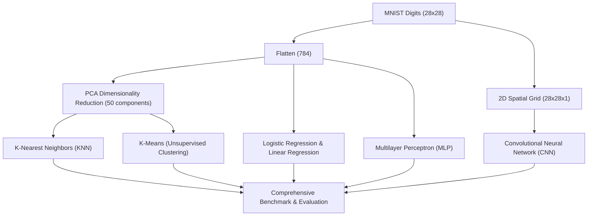

# MNIST Multi-Algorithm Comparative Benchmark
### بنچمارک و مقایسه جامع ۶ الگوریتم یادگیری ماشین و یادگیری عمیق روی داده‌های MNIST

> 🎓 **Academic Note:** This project was developed as a comprehensive research and practical assignment for the **Machine Learning & Deep Learning Course** to analyze the performance, accuracy, and computational trade-offs of 6 distinct learning paradigms on the classic MNIST handwritten digits dataset.

---

## 📌 Project Overview (معرفی پروژه)

دیتاست MNIST (شامل ۷۰,۰۰۰ تصویر ۲۸×۲۸ از ارقام دست‌نویس ۰ تا ۹) استاندارد طلایی ارزیابی الگوریتم‌های هوش مصنوعی است. در این پروژه، ۶ الگوریتم از پارادایم‌های مختلف بر روی یک مجموعه داده یکسان پیاده‌سازی، آموزش و مقایسه شده‌اند:

1. **رگرسیون خطی (Linear Regression):** به عنوان یک مدل پایه (Baseline) برای سنجش توانایی مدل‌های خطی پیوسته روی تسک‌های گسسته.
2. **رگرسیون لجستیک (Logistic Regression):** دسته‌بند خطی چندکلاسه استاندارد.
3. **کاهش بعد با PCA + نزدیک‌ترین همسایه (KNN):** کاهش بعد ویژگی‌ها از ۷۸۴ به ۵۰ مولفه اصلی با تحلیل مولفه‌های اساسی (PCA) و سپس دسته‌بندی با الگوریتم KNN.
4. **خوشه‌بندی K-Means (یادگیری بدون نظارت):** خوشه‌بندی بدون نظارت ارقام در ۱۰ کلاستر و تخصیص برچسب با رای‌گیری حداکثری (Majority Voting).
5. **شبکه عصبی پرسپترون چندلایه (MLP):** شبکه عمیق Fully Connected با لایه‌های Batch Normalization، تابع فعال‌ساز ReLU و Dropout (0.3).
6. **شبکه عصبی کانوولوشنی (CNN):** شبکه کانوولوشنی دوبعدی (Conv2D + MaxPooling) با Dropout (0.5) جهت استخراج ویژگی‌های مکانی تصویر.

---

## 📊 Comparative Summary (جدول مقایسه الگوریتم‌ها)

| ردیف | الگوریتم (Algorithm) | پارادایم یادگیری | روش استخراج ویژگی / ساختار |
| :---: | :--- | :--- | :--- |
| ۱ | **Linear Regression** | Supervised (Linear) | ۷۸۴ پیکسل خام |
| ۲ | **Logistic Regression** | Supervised (Linear Classifier) | ۷۸۴ پیکسل خام با بهینه‌سازی L-BFGS |
| ۳ | **PCA (50) + KNN** | Instance-Based Learning | کاهش بعد به ۵۰ مولفه (توضیح واریانس بالا) |
| ۴ | **PCA (50) + K-Means** | Unsupervised Clustering | خوشه‌بندی فضایی بدون برچسب اولیه |
| ۵ | **MLP (Deep ANN)** | Deep Learning (Dense) | Input(784) ➔ Dense(256) ➔ Dense(128) ➔ Output(10) |
| ۶ | **CNN (ConvNet)** | Deep Learning (Spatial) | Conv2D(32) ➔ MaxPool ➔ Conv2D(64) ➔ Dense(128) |

---

## 🏗️ Architecture Comparison (نمودار مقایسه ساختار)



---

## 📂 Project Structure (ساختار فایل‌ها)

```text
mnist-algorithms-benchmark/
│
├── models_on_mnist.py    # اسکریپت جامع آموزش و بنچمارک ۶ الگوریتم با خروجی نهایی
├── mnist_knn.ipynb       # جوپیتر نوت‌بوک تحلیل بصری، تحلیل ابعاد و الگوریتم KNN
├── requirements.txt      # کتابخانه‌های مورد نیاز (TensorFlow, Scikit-Learn, etc.)
├── .gitignore            # فایل‌های نادیده گرفته‌شده توسط گیت
└── README.md             # مستندات پروژه
```

---

## ⚙️ Installation & Usage (نحوه نصب و اجرا)

### ۱. نصب وابستگی‌ها
```bash
pip install -r requirements.txt
```

### ۲. اجرای بنچمارک کامل
اسکریپت به صورت هوشمند در صورت نبود فایل‌های سنگین CSV محلی، دیتاست را مستقیماً از طریق Keras بارگذاری می‌کند:
```bash
python models_on_mnist.py
```

### ۳. بررسی نوت‌بوک تحلیل بصری
```bash
jupyter notebook mnist_knn.ipynb
```

---

## 🛠️ Technologies Used (فناوری‌های به‌کار رفته)
- **Python 3.10+**
- **TensorFlow / Keras:** MLP and CNN implementations
- **Scikit-Learn:** PCA, Logistic Regression, KNN, KMeans
- **Pandas & NumPy:** Data loading and matrix manipulation
- **Jupyter Notebook:** Exploratory analysis
