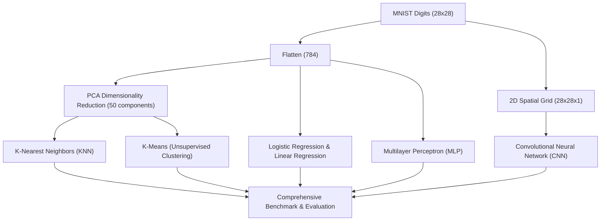

# MNIST Multi-Algorithm Comparative Benchmark

> 🎓 **Academic Note:** This project was developed as a comprehensive benchmark assignment for the **Machine Learning & Deep Learning Course** to analyze the accuracy, convergence, and computational trade-offs of 6 distinct learning paradigms on the classic MNIST handwritten digits dataset.

---

## 📌 Project Overview

The MNIST dataset (70,000 grayscale $28 \times 28$ images across 10 classes) is the benchmark standard for evaluating machine learning algorithms. In this project, 6 distinct algorithmic paradigms are implemented, trained, and benchmarked under a unified evaluation pipeline:

1. **Linear Regression:** Baseline model investigating continuous projection applied to discrete multi-class classification.
2. **Logistic Regression:** Multinomial linear classifier trained with L-BFGS optimization.
3. **PCA + K-Nearest Neighbors (KNN):** Dimensionality reduction condensing 784 pixel dimensions to 50 principal components, followed by distance-based classification.
4. **PCA + K-Means (Unsupervised Clustering):** Unsupervised spatial clustering into 10 partitions, mapping clusters to digit labels via majority voting.
5. **Multilayer Perceptron (MLP):** Deep fully connected neural network with Batch Normalization, ReLU activations, and Dropout (0.3).
6. **Convolutional Neural Network (CNN):** 2D ConvNet (Conv2D + MaxPooling) with spatial feature extraction and Dropout (0.5).

---

## 📊 Comparative Summary

| # | Algorithm | Learning Paradigm | Feature Representation / Architecture |
| :-: | :--- | :--- | :--- |
| 1 | **Linear Regression** | Supervised (Linear Baseline) | 784 flattened raw pixels |
| 2 | **Logistic Regression** | Supervised (Linear Classifier) | 784 raw pixels, L-BFGS solver |
| 3 | **PCA (50) + KNN** | Instance-Based Learning | 50 Principal Components (high variance preserved) |
| 4 | **PCA (50) + K-Means** | Unsupervised Clustering | Spatial clustering without initial ground truth labels |
| 5 | **MLP (Deep ANN)** | Deep Learning (Dense) | Input(784) ➔ Dense(256) ➔ Dense(128) ➔ Softmax(10) |
| 6 | **CNN (ConvNet)** | Deep Learning (Spatial) | Conv2D(32) ➔ MaxPool ➔ Conv2D(64) ➔ Dense(128) |

---

## 🏗️ Architecture Comparison



---

## 📂 Project Structure

```text
mnist-algorithms-benchmark/
│
├── models_on_mnist.py    # Unified benchmark script evaluating all 6 algorithms
├── mnist_knn.ipynb       # Jupyter notebook with exploratory analysis & PCA-KNN experiments
├── requirements.txt      # Project dependencies (TensorFlow, Scikit-Learn, etc.)
├── .gitignore            # Files excluded from version control
└── README.md             # Project documentation
```

---

## ⚙️ Installation & Usage

### 1. Clone the repository
```bash
git clone https://github.com/RahaVefghi/mnist-algorithms-benchmark.git
cd mnist-algorithms-benchmark
```

### 2. Install dependencies
```bash
pip install -r requirements.txt
```

### 3. Run the complete benchmark
The benchmark automatically falls back to fetching MNIST through Keras if local CSV files are absent, running out-of-the-box without manual downloads:
```bash
python models_on_mnist.py
```

### 4. Interactive notebook analysis
```bash
jupyter notebook mnist_knn.ipynb
```

---

## 🛠️ Technologies Used
- **Python 3.10+**
- **TensorFlow / Keras:** MLP and CNN implementations, dataset loader
- **Scikit-Learn:** PCA, LogisticRegression, LinearRegression, KNeighborsClassifier, KMeans
- **Pandas & NumPy:** Tabular data processing and matrix operations
- **Matplotlib:** Comparison visualization
